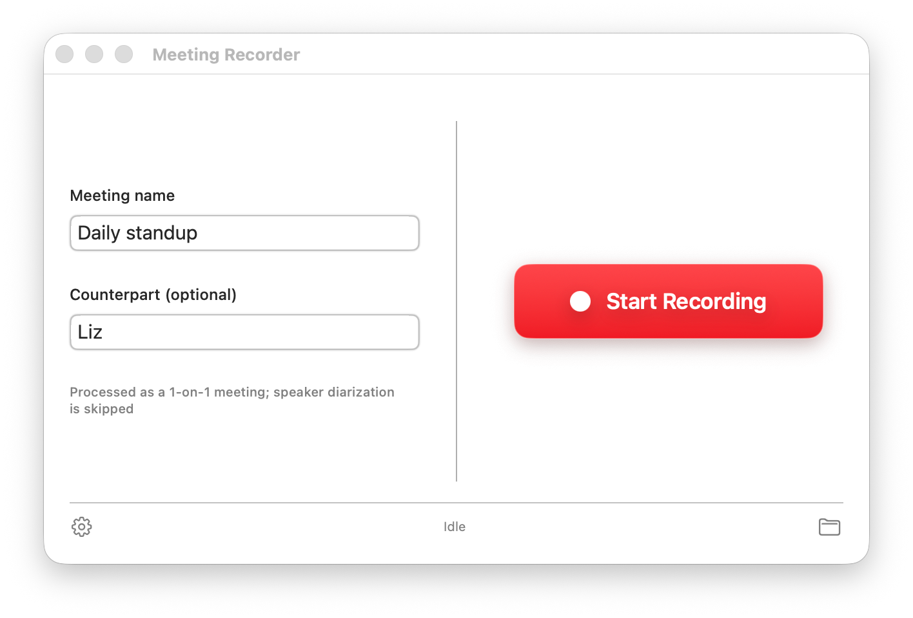
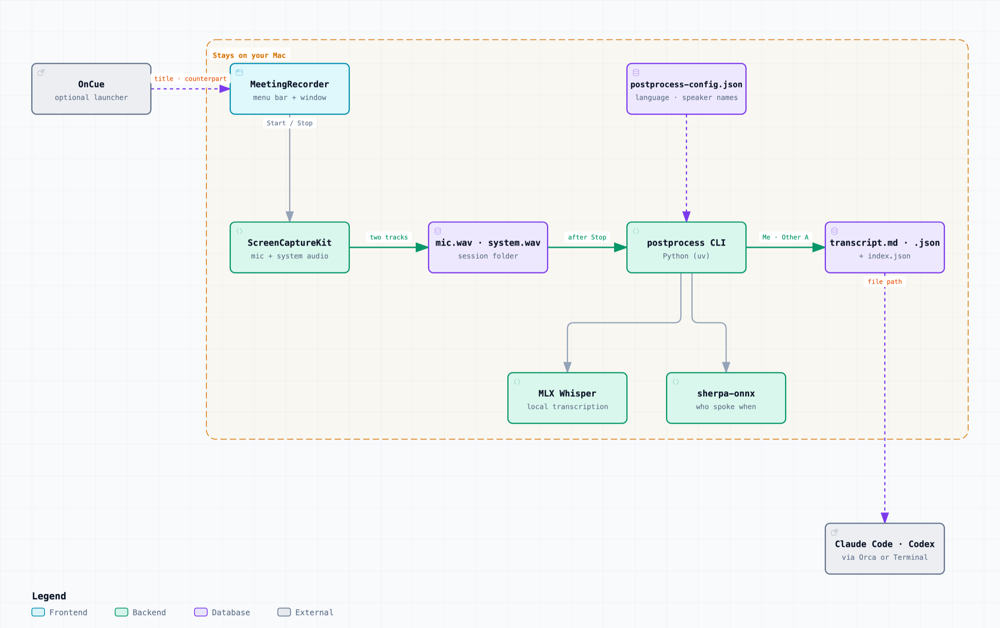

# MeetingRecorder

English | [日本語](README.ja.md)

**Keep a searchable record of every meeting without taking notes, and without sending a second of audio to the cloud.**

<p align="center">
  
</p>

A macOS app that records an online meeting (Google Meet, Zoom, Teams, …) and
transcribes it with speaker separation **entirely on your own Mac**. Nothing
is uploaded anywhere unless you explicitly turn on a feature that does.

Your own microphone and the meeting's system audio (the other side) are
recorded as **two separate WAV files** in sync, then post-processed into a
transcript that tells "you" and "the other side" apart. Recording and
transcription never leave this Mac. Once the transcript is written, the
source audio is deleted by default (you can opt to keep it).

## Why MeetingRecorder

**Without it**

- Taking notes during a meeting pulls your attention away from the
  conversation. Skipping notes means you forget what was decided and who
  promised what.
- Most recording and transcription services upload the audio to the cloud,
  which you often cannot (or are not sure you may) do for confidential or
  client meetings.
- Transcribing a single mixed recording loses who said what. Your words and
  the other side's end up in one undifferentiated stream.
- Audio files pile up, eat disk space, and sensitive recordings linger long
  after you needed them.
- Handing a transcript to an AI agent for a summary or a task list takes
  manual cleanup, because every tool produces a different format.

**With it**

- One click starts recording. Launched from [OnCue](https://github.com/GentaAmeku/OnCue),
  the meeting title and the other person's name are filled in for you.
- Your microphone and the meeting audio are recorded as separate tracks, so
  the transcript always knows which side spoke.
- Transcription (MLX Whisper) and speaker separation (sherpa-onnx) run on
  this Mac. The audio never leaves it.
- You get a conversation log split into "me / other A / other B" in Markdown
  and JSON, plus an index of every session, ready to hand to an AI agent.
- Once the transcript is saved, the source audio is deleted by default. What
  remains is text.
- The transcript can be handed straight to Claude Code or Codex right after
  it's written, so summarizing or triaging it is the agent's job, not yours.

## How it works

<p align="center">
  
</p>

Recording, transcription and speaker separation all run inside the
"Stays on your Mac" boundary. Only the optional AI-agent handoff reaches
outside it. The diagram is generated with
[Archify](https://github.com/tt-a1i/archify) from
[`assets/architecture.archify.json`](assets/architecture.archify.json).

## Before you record

- **Get consent.** Recording a meeting, especially the other participants,
  may require their consent depending on where you and they are — check the
  wiretapping/recording-consent rules that apply to your call (they vary a
  lot by country and by US state, and this project cannot tell you which
  ones apply). When in doubt, ask everyone on the call first.
- **This is a personal tool, not a compliance product.** It has no
  organization-wide retention policy, no consent-recording feature, and no
  audit log. Don't point it at a meeting where those matter without adding
  your own process around it.

## What it does

### Recording

- Your microphone → `mic.wav`, the Mac's system audio (the other
  participants) → `system.wav`, captured at the same time as one
  ScreenCaptureKit stream so they stay in sync.
- Start/stop and status from the menu bar, or the main window.
- Optional meeting name and counterpart name before you start (used in the
  folder name and the transcript).
- Optional auto-stop after 2 minutes of silence (a real end-of-call silence,
  not typing or background noise — it uses speech detection, not volume, and
  only arms after the first speech is detected so it won't fire before the
  call starts).

### Local transcription and speaker separation

- After you stop recording, a local **MLX Whisper** run always transcribes
  the audio (a model download is required the first time; if the required
  model isn't downloaded yet, the app tells you so instead of transcribing).
- Produces `transcript.md` (`[MM:SS] Me: …` / `[MM:SS] Other: …`) and a structured
  `transcript.json`.
- **The source `mic.wav` / `system.wav` are deleted by default** once both
  transcript files are written successfully — turn on "Keep the original audio
  files" in Settings to keep them instead. This is deliberate: this project
  treats the transcript, not the raw recording, as what you actually need
  once it exists.
- When there's more than one person on the other side, **sherpa-onnx**
  separates them into "Other A / Other B …".
- A per-machine `index.json` catalogs every session so an AI agent (or you)
  can search across all of them.
- **Transcription language**: Settings has a "Transcription language" picker
  (Auto-detect / English / Japanese). Auto-detect is the default and lets
  MLX Whisper identify the spoken language on its own; picking a language
  writes it to `postprocess-config.json` (`transcript.language`), which the
  `postprocess` CLI also reads directly if you run it by hand. Codes (`ja`)
  and names (`Japanese`) are accepted in any case; an unsupported value falls
  back to auto-detect. Auto-detect runs per speech segment, so a very short
  utterance can be misdetected — pick the language when you know it.
- **Speaker names**: the transcript calls you "Me" and the other side
  "Other" (or "Other A" / "Other B" … when there's more than one), unless you
  set a counterpart name when starting the recording. Both names can be
  changed for every future transcript via `transcript.selfName` /
  `transcript.otherName` in `postprocess-config.json` — see
  [postprocess/README.md](postprocess/README.md#configuration-postprocess-configjson).
  Letters are appended with a space ("Other A"), or without one when the name
  ends in CJK script ("相手A").

### Optional: launch from OnCue

If you also use **OnCue**, a separate menu-bar app for preparing meetings, it
can hand MeetingRecorder a meeting's title, counterpart name and Google Meet
link over a custom URL
(`meetingrecorder://prepare?title=...&counterpart=...&join=...`) instead of
you typing them in by hand.

- `title` is required, `counterpart` is optional, and `join` is required and
  must be an `https://meet.google.com/...` link — anything else (a different
  scheme or host, unknown/duplicate query items, a non-Meet `join` URL) is
  rejected outright and surfaced as a banner instead of being silently
  applied.
- While you're already recording (or a recording is being finalized), an
  incoming request is ignored — the meeting you're recording keeps its title
  and counterpart, and a banner tells you nothing changed.
- MeetingRecorder works entirely on its own without OnCue; this is purely a
  convenience for people who also use it, and OnCue is not part of this
  repository.

### Optional: hand off to an AI agent after transcription

Off by default (Target = "None"). When configured, MeetingRecorder
launches your chosen AI agent — **Claude Code** or **Codex** — in a working
folder right after the automatic post-recording transcription finishes, and
sends it a prompt. MeetingRecorder itself only passes the transcript's
*location* (a file path) — the agent reads the file itself.

> **The transcript does leave your Mac at this step.** Claude Code and Codex
> send what they read to their providers' cloud models (Anthropic and
> OpenAI). The audio stays local, but the transcript text reaches those
> services under your own account and their terms. Leave Target at
> "none" for meetings whose content must stay on this Mac.

- Settings: **Target** (None / Claude Code / Codex), **Open with**
  (Orca / Terminal), a **Working directory** (where the agent is launched),
  a multi-line **prompt** (placeholders `{transcript}`, `{session}`,
  `{title}`, `{counterpart}` are substituted; an empty prompt falls back to
  the default), and an optional **meeting-title filter** (empty = always).
  `{title}` and `{counterpart}` can come from outside (for example from an
  OnCue link), so treat them as untrusted text inside your prompt.
- **Opening via Orca** creates a new Orca terminal, waits for it to be ready
  for input, then sends the prompt. The working directory must already be
  registered with Orca (as a worktree/folder context) — Orca can't open an
  unregistered folder.
- **Opening via Terminal** launches `claude` or `codex` interactively in the
  working directory using macOS's Terminal.app, with the prompt as its
  argument. The app can only confirm that Terminal opened; if the folder is
  gone or the command isn't on your `PATH`, you'll see that in the Terminal
  window rather than in the app.
- Both `claude` and `codex` are resolved through your login shell's `PATH`,
  so make sure whichever one you use is on it.
- **When it runs:** only when the automatic transcription of the session you
  just stopped succeeds (both transcript files written), Target isn't
  "None", a working directory is set, and the meeting title matches the
  filter. It does **not** run for the manual "Transcribe Now (Pending)" bulk
  action. A failure here never affects the recording or transcript — the app
  just shows a brief status (success, or why it failed).
- **This launches a local AI agent that can read your meeting content,
  automatically and unattended.** Only point it at an agent you trust.

## Requirements

- **macOS 15.6 (Sequoia) or later** (ScreenCaptureKit's single-stream capture
  of mic + system audio together).
- To transcribe: Apple Silicon (MLX runs on the GPU) and
  [uv](https://docs.astral.sh/uv/).
- Xcode 26 or later to build the app, tested with Xcode 26.4. There is no signed release build —
  see [SETUP.md](SETUP.md).

### Permissions

| Permission | What it's for |
| --- | --- |
| Microphone | Recording your own voice |
| Screen & System Audio Recording | Recording the other side's voice (system audio) |
| Files and Folders — Documents Folder | Recordings/transcripts live under `~/Documents/MeetingRecorder`; the transcription subprocess reads/writes there |
| Full Disk Access (last resort) | Only if the Documents-folder grant above isn't enough. A plain folder outside the protected set (Desktop/Documents/Downloads/iCloud Drive, …) needs no permission at all, so this is for the opposite case: the `postprocess` CLI/venv sitting *inside* one of those other protected/synced locations (e.g. iCloud Drive) that the Documents-folder grant doesn't cover |

The Mac's single-stream capture means **screen recording permission is
required even though no video is kept** — without it, the microphone can't
be recorded either. The app disables the record button and points at System
Settings when a permission is missing.

macOS prompts for the Documents-folder grant automatically the first time
the app or the transcription subprocess touches `~/Documents` — there's
nothing to configure for it up front. Reach for Full Disk Access only if
transcription still fails with a permission error afterward.

## Setup

Building and running this from source is a bit involved — Xcode signing
settings, a Python side project, and downloaded models. **[SETUP.md](SETUP.md)**
walks through all of it step by step ([SETUP.ja.md](SETUP.ja.md) in
Japanese). Short version:

```sh
git clone https://github.com/GentaAmeku/MeetingRecorder.git
cd MeetingRecorder
cp MeetingRecorder/Configuration/Local.xcconfig.example MeetingRecorder/Configuration/Local.xcconfig
# edit Local.xcconfig: your DEVELOPMENT_TEAM and MEETING_RECORDER_BUNDLE_ID_PREFIX
open MeetingRecorder/MeetingRecorder.xcodeproj   # build & run from Xcode

scripts/install_app.sh                            # only needed for transcription
# builds and installs, including postprocess's `uv sync`, and wires up the
# CLI location automatically
```

Distribution is **build-from-source only** — there is no signed/notarized
release and no Homebrew formula.

## Usage

1. Launch the app.
2. Optionally set the microphone, meeting name and counterpart name.
3. Press **Start Recording** during the meeting.
4. Press **Stop** when the meeting ends (the transcript is produced right
   after).
5. Use **Show in Finder** to see the recording/transcript.

Recordings are saved to
`~/Documents/MeetingRecorder/recordings/<date>_<meeting name>/`:

```
~/Documents/MeetingRecorder/recordings/
  index.json                       # catalog of every session
  2026-06-30_1530_weekly-sync/
    mic.wav        # deleted by default after transcription (kept if you opt in)
    system.wav     # deleted by default after transcription (kept if you opt in)
    metadata.json
    transcript.md  # Me/Other conversation log
    transcript.json
```

## Known limits

- The app's UI is English only, with no runtime language switch or
  localization framework — changing it means editing the source. The
  transcript's speaker names and transcription language are independently
  configurable at runtime (see above); the AI-agent hand-off prompt template
  defaults to an English prompt as well, but you can edit it to whatever
  language you like in Settings.

## Third-party models and licenses

Transcription and speaker separation use downloaded third-party models —
see [THIRD_PARTY_NOTICES.md](THIRD_PARTY_NOTICES.md) for what license each
one is published under and what it was checked against.

## More detail

- Transcription pipeline internals and CLI options:
  [postprocess/README.md](postprocess/README.md)

## License

[MIT](LICENSE).
